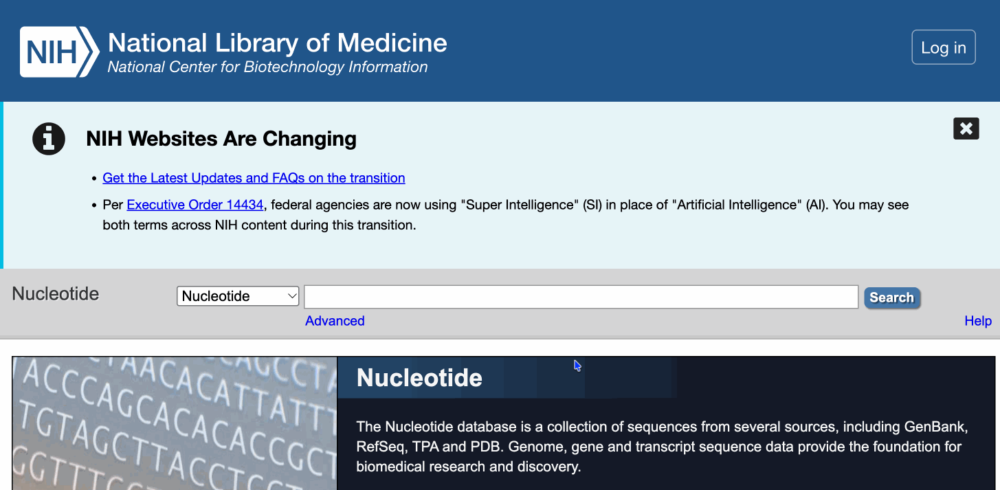

## Biotite Fetch Genbank from Accession

We can search for biological sequences using the NCBI databases. You may have done this before via the webpage. In this example, we're going to look at a plasmid found in  *Staphylococcus* which contains genes that allow the bacteria to become resistant to different drugs - plasmid pSS-01. 

We can use the accession number to ask python (using the biotite library) to fetch the sequence directly from the database. 

First, let's have a look at the plasmid and gather the accession number using the website. We'll use [NCBI nucleotide](https://www.ncbi.nlm.nih.gov/nucleotide/) and type in "plasmid pSS-01". There are two records, these are both the same sequence from the same study so we'll use the first one as the annotation is more detailed. 



The result we found was: 

**Accession number**: `JQ041372.1` 

**Study**: [Distribution of the multidrug resistance gene cfr in Staphylococcus species isolates from swine farms in China](https://doi.org/10.1128/aac.05827-11)

Now we know the accession - we can use Biotite package `biotite.database.entrez` to fetch the GenBank file which contains the sequence and locations of all the genes. 

---

## Biotite Setup

You'll need to use biotite for this section. 

From biotite, we want to import a range of different functions. This include `entrez` which is used to access the NCBI databases, `genbank` for dealing with sequence information which is in genbank format, and `seq` for dealing with sequences. 

```{python}
import biotite.database.entrez as entrez
import biotite.sequence as seq
import biotite.sequence.align as align
import biotite.sequence.graphics as graphics
import biotite.sequence.io.genbank as genbank
```

---

## Fetching Data from NCBI Entrez

The `entrez.fetch()` function allows us to download records from NCBI databases. The nucleotide database is called `nuccore`. 

By passing our target accession string (`JQ041372.1`) to `entrez.fetch()`, Biotite downloads the record and returns the file. 

The genbank file below contains the sequence and all the annotations - details about the sequence, such as the study it came from and the locations of genetic elements such as genes, tRNAs, rRNAs and other genetic elements like transposable elements. 

```{python}
# Define target accession for Staphylococcus cohnii strain 2-8 plasmid pSS-01
ACCESSION = "JQ041372.1"

# print a message before starting the search (as it can take some time, so this helps to show it is running)
print(f"Fetching GenBank record for accession: {ACCESSION}")

# Use entrez.fetch to find the accession, looking in the nucleotide database nuccore, and returning a gb (genbank) file
genbank_file_location = entrez.fetch(
    ACCESSION, # Accession number
    None, # Target path (where to save it on our PC) - we can set to None so it will use a temporary file
    suffix="gb", # Will add a suffix .gb to specify that it is a genbank file
    db_name="nuccore", # Search the nucleotide database 
    ret_type="gb" # Retrieve the genbank file 
)

# Read the downloaded GenBank file
genbank_file = genbank.GenBankFile.read(genbank_file_location)

# Open and print the entire raw GenBank file content
print(f"--- Full GenBank File Content for {ACCESSION} ---")
print(genbank_file)
```

